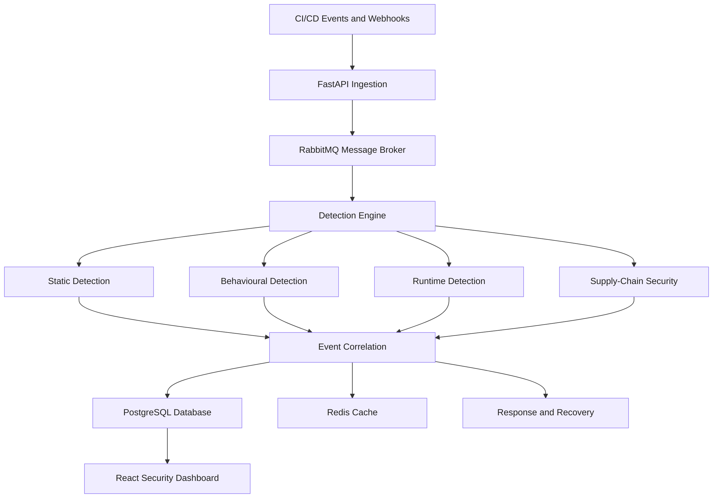

# PipelineSentry
### CI/CD Pipeline Attack Detection and Defence

PipelineSentry is a DevSecOps security platform designed to detect suspicious activity in CI/CD pipelines, correlate security events, and support defensive workflows. It aims to improve software delivery security through layered threat detection, centralized monitoring, and security-focused automation.

CI/CD pipelines are a critical part of modern software development, but compromised credentials, malicious workflow changes, and vulnerable software dependencies can introduce security risks before applications reach production.

PipelineSentry explores a unified approach to pipeline security by combining detection, event correlation, attack simulation, and defensive controls within a single architecture.

## Key Features

- **Multi-Layer Threat Detection:** Analyse pipeline activity through static rules, behavioural patterns, and runtime signals.
- **Event Correlation:** Connect related findings and reduce duplicate security alerts.
- **Attack Simulation Lab:** Evaluate detection capabilities using controlled CI/CD attack scenarios.
- **Centralized Security Dashboard:** Monitor alerts, system health, and security events through a unified interface.
- **Asynchronous Event Processing:** Use message-based processing to decouple event ingestion from downstream analysis.
- **Alert Deduplication and Caching:** Reduce repeated processing and improve alert-handling efficiency.
- **Incident Response and Recovery:** Support structured response and recovery workflows as these modules are implemented.
- **Software Supply-Chain Security:** Explore SBOM generation, artifact verification, and dependency security.
- **Policy-Based Security:** Support security policy definition and validation for pipeline configurations.

## System Architecture

The architecture separates event ingestion, detection, correlation, storage, and visualization. RabbitMQ supports asynchronous processing, PostgreSQL stores persistent application data, and Redis supports caching and deduplication. The dashboard provides a centralized view of security activity.

*The diagram represents the intended high-level design; individual integrations depend on their implementation status.*

## Technology Stack

| Layer | Technologies |
|---|---|
| Backend | Python, FastAPI |
| Database and ORM | PostgreSQL, SQLAlchemy |
| Message Broker | RabbitMQ |
| Caching | Redis |
| Frontend | React, TypeScript, Vite |
| Styling | Tailwind CSS |
| API Integration | Axios |
| Containerization | Docker, Docker Compose |
| Testing | pytest |
| Security Tooling | Semgrep, Trivy, CycloneDX/SPDX, Cosign, OPA/Rego, Kyverno, where integrated |

## Design Principles

- **Layered security:** Combine multiple detection methods rather than relying on a single signal.
- **Modular architecture:** Separate detection, correlation, monitoring, and defensive components.
- **Scalable processing:** Decouple event ingestion from analysis through message-based communication.
- **Traceability:** Maintain structured security findings and support investigation workflows.
- **Safe testing:** Use controlled attack simulations and synthetic events to evaluate defensive behaviour.

## Project Objective

PipelineSentry aims to demonstrate how modern DevSecOps practices can be applied to protect CI/CD pipelines. By combining threat detection, event correlation, monitoring, and defensive security integrations, the project provides a foundation for studying pipeline attack detection and improving software supply-chain resilience.

