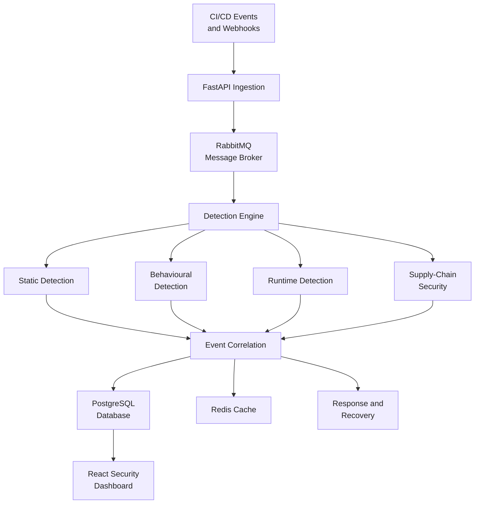

# PipelineSentry
### CI/CD Pipeline Attack Detection and Defence

PipelineSentry is a DevSecOps security platform designed to detect suspicious activity in CI/CD pipelines, correlate security events, and support defensive workflows. It aims to improve software delivery security through layered threat detection, centralized monitoring, and security-focused automation.


CI/CD pipelines are a critical part of modern software development, but compromised credentials, malicious workflow changes, and vulnerable software dependencies can introduce security risks before applications reach production.

PipelineSentry explores a unified approach to pipeline security by combining detection, event correlation, attack simulation, and defensive controls within a single architecture.

## Key Features

- **Multi-Layer Threat Detection:** Analyse pipeline activity through static rules, behavioural patterns, and runtime signals.
- **Event Correlation:** Connect related findings and reduce duplicate security alerts.
- **Attack Simulation Lab:** Evaluate detection capabilities using controlled CI/CD attack scenarios.
- **Centralized Security Dashboard:** Monitor alerts, system health, and security events through a unified interface.
- **Asynchronous Event Processing:** Use message-based processing to decouple event ingestion from downstream analysis.
- **Alert Deduplication and Caching:** Reduce repeated processing and improve alert-handling efficiency.
- **Incident Response and Recovery:** Support structured response and recovery workflows as these modules are implemented.
- **Software Supply-Chain Security:** Explore SBOM generation, artifact verification, and dependency security.
- **Policy-Based Security:** Support security policy definition and validation for pipeline configurations.

## Quick Start

### Prerequisites

| Tool | Version | Needed for |
|---|---|---|
| Docker Desktop / Docker Engine with Compose v2 | 24+ | the whole stack (API, workers, Postgres, RabbitMQ, Redis, registry) |
| Node.js | 18+ (CI uses 20) | the dashboard |
| Python | 3.11+ (optional) | running unit tests outside Docker |
| `make` | optional | Linux/macOS shortcut; Windows uses `scripts\make.ps1` |

Give Docker at least **4 GB of RAM** and free ports `8000`, `5000`, `15672` and `5173`. The image already contains
`opa`, `cosign` and `gitleaks`, so you do not need to install them.

### 1. Start the backend

```bash
# Linux / macOS
make up                          # creates .env from .env.example, builds the image, waits for health

# Windows (PowerShell)
.\scripts\make.ps1 up
```

Check it: `curl http://localhost:8000/health` should show `database`, `rabbitmq` and `redis` as `ok`.
API docs: <http://localhost:8000/docs>. RabbitMQ UI: <http://localhost:15672> (credentials from `.env`).

### 2. Start the dashboard

```bash
cd dashboard
npm ci                           # Windows alternative: INSTALL.bat (installs and starts)
npm run dev                      # http://localhost:5173
```

### 3. Run the demos

```bash
make demo                        # attack scenarios 01, 04, 05, 06, 07 (detection layers)
make demo-m2                     # detection → response → recovery → cosign → SBOM → OPA; ends with RESULT: PASS
make attack ID=03                # a single scenario (01–07)
```

On Windows, use the same targets with `.\scripts\make.ps1`, e.g. `.\scripts\make.ps1 demo-m2` or
`.\scripts\make.ps1 attack 03`.

### 4. Run all checks

| Check | Command | Needs the stack |
|---|---|---|
| Python unit tests (in Docker, all tools present) | `make test-unit` | no |
| Full suite incl. integration (real cosign + registry) | `make test` | yes (starts it) |
| OPA/Rego policy tests | `make test-policy` | no |
| Kyverno admission policy tests (offline) | `make test-kyverno` | no |
| Dashboard type-check and production build | `cd dashboard && npm run build` | no |

Unit tests without Docker: `pip install -r requirements.txt`, then `pytest -q -m "not integration"` from the repository
root. Tests that need `opa` are skipped when it is not installed. The same checks run in
[.github/workflows/ci.yml](.github/workflows/ci.yml).

### Stop / reset

```bash
make down                        # stop, keep data
make reset                       # stop and delete all data volumes (asks for confirmation)
```

### Troubleshooting

| Symptom | Fix |
|---|---|
| `port is already allocated` | change `API_PORT`, `REGISTRY_PORT` or `RABBITMQ_UI_PORT` in `.env` (macOS: AirPlay uses 5000) |
| Build fails with `DeadlineExceeded` or `no such job` | Docker Desktop's Bake integration; run `COMPOSE_BAKE=false docker compose build` (PowerShell: `$env:COMPOSE_BAKE="false"`) and retry `up` |
| RabbitMQ exits with `.erlang.cookie: eacces` | its volume was created half-way; `docker compose rm -sf rabbitmq`, `docker volume rm pipelinesentry_rabbitdata`, then `up` again |
| `api` shows `unhealthy` right after start | it started before RabbitMQ was ready; it reconnects by itself, so wait a few seconds and check `/health` |
| Dashboard shows network errors | the API must be running on `VITE_API_URL` (default `http://localhost:8000`; see `dashboard/.env.example`) |
| Very slow start | other containers are competing for RAM; stop them or give Docker more memory |

## System Architecture

The architecture separates event ingestion, detection, correlation, storage, and visualization. RabbitMQ supports asynchronous processing, PostgreSQL stores persistent application data, and Redis supports caching and deduplication. The dashboard provides a centralized view of security activity.

*The diagram represents the intended high-level design; individual integrations depend on their implementation status.*

## Technology Stack

| Layer | Technologies |
|---|---|
| Backend | Python, FastAPI |
| Database and ORM | PostgreSQL, SQLAlchemy |
| Message Broker | RabbitMQ |
| Caching | Redis |
| Frontend | React, TypeScript, Vite |
| Styling | Tailwind CSS |
| API Integration | Axios |
| Containerization | Docker, Docker Compose |
| Testing | pytest |
| Security Tooling | Semgrep, Trivy, CycloneDX/SPDX, Cosign, OPA/Rego, Kyverno, where integrated |

## Defensive Modules

| Module | What it does | Docs |
|---|---|---|
| `response/` | Playbook-driven response to correlated incidents in dry-run, simulated or (GitHub run cancellation only) live mode, with a full audit trail | [response/README.md](response/README.md) |
| `recovery/` | Simulated recovery of contained resources with prerequisite checks and manual-intervention handling | [recovery/README.md](recovery/README.md) |
| `supply_chain/` | CycloneDX SBOMs and cosign signing/verification against a local registry, fed back into detection | [supply_chain/README.md](supply_chain/README.md) |
| `policy/` | OPA/Rego evaluation of Kubernetes manifests and workflows, plus Kyverno admission policies | [policy/README.md](policy/README.md) |

How they connect to the detection engine, the full demo (`make demo-m2`) and what is simulated: [INTEGRATION.md](INTEGRATION.md).

## Design Principles

- **Layered security:** Combine multiple detection methods rather than relying on a single signal.
- **Modular architecture:** Separate detection, correlation, monitoring, and defensive components.
- **Scalable processing:** Decouple event ingestion from analysis through message-based communication.
- **Traceability:** Maintain structured security findings and support investigation workflows.
- **Safe testing:** Use controlled attack simulations and synthetic events to evaluate defensive behaviour.

## Project Objective

PipelineSentry aims to demonstrate how modern DevSecOps practices can be applied to protect CI/CD pipelines. By combining threat detection, event correlation, monitoring, and defensive security integrations, the project provides a foundation for studying pipeline attack detection and improving software supply-chain resilience.

